# Avaliação 08 – Agregação de Links (EtherChannel / LACP) e Trunk

**Disciplina:** TCN.0639 – Comutação de Redes Locais  
**Curso:** Tecnologia em Redes de Computadores – IFRO Campus Porto Velho Zona Norte  
**Aluno:** Saulo Viana de Queiroz  
**Ferramenta:** Cisco Packet Tracer

## 1. Objetivo

Configurar canais de agregação de links (EtherChannel) entre os switches do ambiente hierárquico: **2 Gbps** entre cada switch de distribuição e seu switch de núcleo, e **4 Gbps** entre os dois switches de núcleo. As interfaces lógicas resultantes (Port-channels) foram configuradas como trunk 802.1Q, mantendo as VLANs 10 (Alunos) e 20 (Visitantes) das avaliações anteriores. Ao final, a conectividade foi validada com ping e tracert entre ramos opostos da topologia.

## 2. Fundamentação

### 2.1 Agregação de links

A agregação de links junta várias interfaces físicas em um único enlace lógico. A Cisco chama esse recurso de **EtherChannel**, e a interface lógica criada é o **Port-channel**. Os benefícios são:

- **Largura de banda:** a capacidade total é a soma dos membros (ex.: 4 × 1 Gbps = 4 Gbps).
- **Redundância:** se um membro falhar, o canal continua operando com os demais.
- **Spanning Tree:** o STP enxerga o Port-channel como um único enlace e deixa de bloquear os cabos paralelos.
- **Balanceamento de carga:** o switch distribui os quadros entre os membros por um cálculo (hash) sobre endereços do quadro. Cada fluxo usa um único membro; o ganho aparece com vários fluxos simultâneos.

### 2.2 Protocolos de negociação

| Protocolo | Origem | Modos | Observação |
|---|---|---|---|
| PAgP (Port Aggregation Protocol) | Cisco (proprietário) | `desirable` (inicia) / `auto` (responde) | Só entre equipamentos Cisco |
| LACP (Link Aggregation Control Protocol) | IEEE 802.3ad (padrão aberto, hoje mantido na IEEE 802.1AX) | `active` (inicia) / `passive` (responde) | Interoperável entre fabricantes |
| Estático | — | `on` | Sem negociação; os dois lados precisam estar em `on` |

Combinações que formam o canal: `active`+`active`, `active`+`passive`, `desirable`+`desirable`, `desirable`+`auto` e `on`+`on`. Não formam: `passive`+`passive`, `auto`+`auto` e qualquer mistura de protocolos.

### 2.3 Requisitos dos membros

Todas as interfaces de um mesmo canal precisam ter a mesma velocidade e duplex, o mesmo modo (trunk), a mesma VLAN nativa e a mesma lista de VLANs permitidas. Uma interface diferente é suspensa do canal.

### 2.4 Escolha desta implementação

Foi usado **LACP em modo `active` nos dois lados** de todos os canais, por ser o padrão aberto e porque os dois lados iniciam a negociação.

## 3. Diagrama da topologia

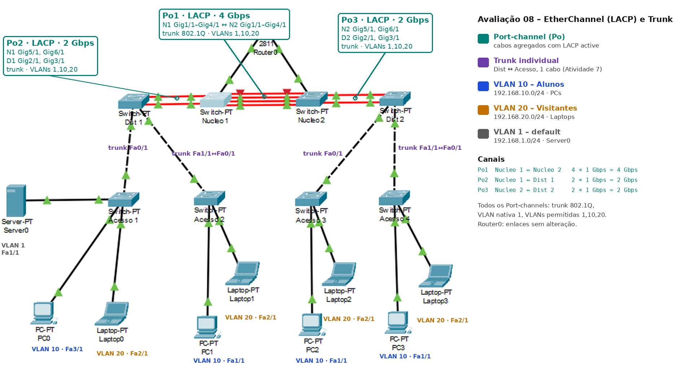

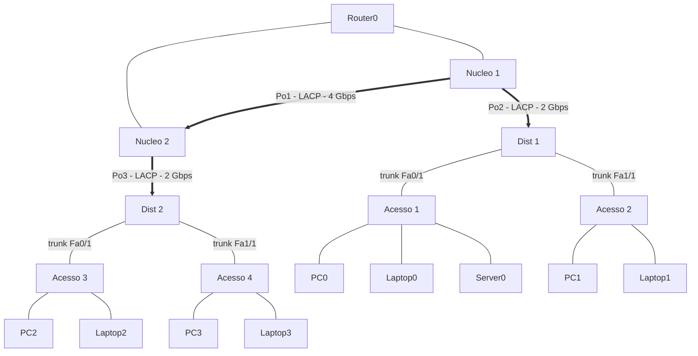

## 4. Documentação técnica

### 4.1 VLANs

| ID | Nome | Rede IP | Dispositivos |
|---|---|---|---|
| 10 | Alunos | 192.168.10.0/24 | PC0, PC1, PC2, PC3 |
| 20 | Visitantes | 192.168.20.0/24 | Laptop0, Laptop1, Laptop2, Laptop3 |
| 1 | default | 192.168.1.0/24 | Server0 |

### 4.2 Canais de agregação (Port-channels)

| Canal | Switch A | Membros em A | Switch B | Membros em B | Protocolo / modo | Capacidade | Trunk |
|---|---|---|---|---|---|---|---|
| Port-channel1 | Nucleo 1 | GigabitEthernet1/1, GigabitEthernet2/1, GigabitEthernet3/1, GigabitEthernet4/1 | Nucleo 2 | GigabitEthernet1/1, GigabitEthernet2/1, GigabitEthernet3/1, GigabitEthernet4/1 | LACP active / active | 4 × 1 Gbps = **4 Gbps** | 802.1Q, nativa 1, VLANs 1,10,20 |
| Port-channel2 | Nucleo 1 | GigabitEthernet5/1, GigabitEthernet6/1 | Dist 1 | GigabitEthernet2/1, GigabitEthernet3/1 | LACP active / active | 2 × 1 Gbps = **2 Gbps** | 802.1Q, nativa 1, VLANs 1,10,20 |
| Port-channel3 | Nucleo 2 | GigabitEthernet5/1, GigabitEthernet6/1 | Dist 2 | GigabitEthernet2/1, GigabitEthernet3/1 | LACP active / active | 2 × 1 Gbps = **2 Gbps** | 802.1Q, nativa 1, VLANs 1,10,20 |

### 4.3 Mapeamento de interfaces físicas e lógicas

| Switch | Interface física | Interface lógica | Conectada a | Modo |
|---|---|---|---|---|
| Nucleo 1 | GigabitEthernet1/1 | Port-channel1 | Nucleo 2 | membro LACP (active) |
| Nucleo 1 | GigabitEthernet2/1 | Port-channel1 | Nucleo 2 | membro LACP (active) |
| Nucleo 1 | GigabitEthernet3/1 | Port-channel1 | Nucleo 2 | membro LACP (active) |
| Nucleo 1 | GigabitEthernet4/1 | Port-channel1 | Nucleo 2 | membro LACP (active) |
| Nucleo 1 | GigabitEthernet5/1 | Port-channel2 | Dist 1 | membro LACP (active) |
| Nucleo 1 | GigabitEthernet6/1 | Port-channel2 | Dist 1 | membro LACP (active) |
| Nucleo 2 | GigabitEthernet1/1 | Port-channel1 | Nucleo 1 | membro LACP (active) |
| Nucleo 2 | GigabitEthernet2/1 | Port-channel1 | Nucleo 1 | membro LACP (active) |
| Nucleo 2 | GigabitEthernet3/1 | Port-channel1 | Nucleo 1 | membro LACP (active) |
| Nucleo 2 | GigabitEthernet4/1 | Port-channel1 | Nucleo 1 | membro LACP (active) |
| Nucleo 2 | GigabitEthernet5/1 | Port-channel3 | Dist 2 | membro LACP (active) |
| Nucleo 2 | GigabitEthernet6/1 | Port-channel3 | Dist 2 | membro LACP (active) |
| Dist 1 | GigabitEthernet2/1 | Port-channel2 | Nucleo 1 | membro LACP (active) |
| Dist 1 | GigabitEthernet3/1 | Port-channel2 | Nucleo 1 | membro LACP (active) |
| Dist 2 | GigabitEthernet2/1 | Port-channel3 | Nucleo 2 | membro LACP (active) |
| Dist 2 | GigabitEthernet3/1 | Port-channel3 | Nucleo 2 | membro LACP (active) |
| Dist 1 | FastEthernet0/1 | — | Acesso 1 (Fa0/1) | trunk individual (VLANs 1,10,20) |
| Dist 1 | FastEthernet1/1 | — | Acesso 2 (Fa0/1) | trunk individual (VLANs 1,10,20) |
| Dist 2 | FastEthernet0/1 | — | Acesso 3 (Fa0/1) | trunk individual (VLANs 1,10,20) |
| Dist 2 | FastEthernet1/1 | — | Acesso 4 (Fa0/1) | trunk individual (VLANs 1,10,20) |
| Acesso 1 | FastEthernet0/1 | — | Dist 1 (Fa0/1) | trunk individual (VLANs 1,10,20) |
| Acesso 2 | FastEthernet0/1 | — | Dist 1 (Fa1/1) | trunk individual (VLANs 1,10,20) |
| Acesso 3 | FastEthernet0/1 | — | Dist 2 (Fa0/1) | trunk individual (VLANs 1,10,20) |
| Acesso 4 | FastEthernet0/1 | — | Dist 2 (Fa1/1) | trunk individual (VLANs 1,10,20) |
| Nucleo 1 / Nucleo 2 | portas do Router0 | — | Router0 | sem alteração (fora do escopo) |

### 4.4 Portas de acesso e endereçamento (Avaliação 06, sem alteração)

| Switch | Interface | Dispositivo | IP | VLAN |
|---|---|---|---|---|
| Acesso 1 | FastEthernet3/1 | PC0 | 192.168.10.10 | 10 – Alunos |
| Acesso 1 | FastEthernet2/1 | Laptop0 | 192.168.20.10 | 20 – Visitantes |
| Acesso 1 | FastEthernet1/1 | Server0 | 192.168.1.10 | 1 – default |
| Acesso 2 | FastEthernet1/1 | PC1 | 192.168.10.11 | 10 – Alunos |
| Acesso 2 | FastEthernet2/1 | Laptop1 | 192.168.20.11 | 20 – Visitantes |
| Acesso 3 | FastEthernet1/1 | PC2 | 192.168.10.12 | 10 – Alunos |
| Acesso 3 | FastEthernet2/1 | Laptop2 | 192.168.20.12 | 20 – Visitantes |
| Acesso 4 | FastEthernet1/1 | PC3 | 192.168.10.13 | 10 – Alunos |
| Acesso 4 | FastEthernet2/1 | Laptop3 | 192.168.20.13 | 20 – Visitantes |

## 5. Comandos Cisco IOS

### 5.1 Explicação dos comandos

| Comando | Modo | Função |
|---|---|---|
| `enable` | `Switch>` | Entra no modo privilegiado |
| `configure terminal` | `Switch#` | Entra no modo de configuração global |
| `interface GigabitEthernetX/Y` | `Switch(config)#` | Seleciona a interface física |
| `shutdown` / `no shutdown` | `Switch(config-if)#` | Desliga e religa a interface durante a inclusão no canal |
| `channel-group N mode active` | `Switch(config-if)#` | Inclui a interface no canal N com LACP ativo; cria a interface Port-channel N |
| `interface Port-channel N` | `Switch(config)#` | Seleciona a interface lógica do canal |
| `description TEXTO` | `Switch(config-if)#` | Descrição da interface |
| `switchport mode trunk` | `Switch(config-if)#` | Coloca o canal em modo trunk |
| `switchport trunk allowed vlan LISTA` | `Switch(config-if)#` | Define as VLANs permitidas no canal |
| `end` | qualquer modo de configuração | Volta ao modo privilegiado |
| `copy running-config startup-config` | `Switch#` | Salva a configuração na NVRAM |
| `show etherchannel summary` | `Switch#` | Resumo dos canais, protocolo e estado dos membros |
| `show interfaces port-channel N` | `Switch#` | Estado e largura de banda (BW) do canal |
| `show interfaces trunk` | `Switch#` | Interfaces trunk e VLANs permitidas |

### 5.2 Sequência de configuração

Ordem: Nucleo 1 → Nucleo 2 → Dist 1 → Dist 2. Os switches de acesso não foram alterados nesta avaliação.

#### 5.2.1 Nucleo 1

```
enable
configure terminal
interface GigabitEthernet1/1
 shutdown
 channel-group 1 mode active
 no shutdown
 exit
interface GigabitEthernet2/1
 shutdown
 channel-group 1 mode active
 no shutdown
 exit
interface GigabitEthernet3/1
 shutdown
 channel-group 1 mode active
 no shutdown
 exit
interface GigabitEthernet4/1
 shutdown
 channel-group 1 mode active
 no shutdown
 exit
interface GigabitEthernet5/1
 shutdown
 channel-group 2 mode active
 no shutdown
 exit
interface GigabitEthernet6/1
 shutdown
 channel-group 2 mode active
 no shutdown
 exit
interface Port-channel1
 description ETHERCHANNEL 4G para Nucleo 2
 switchport mode trunk
 switchport trunk allowed vlan 1,10,20
 exit
interface Port-channel2
 description ETHERCHANNEL 2G para Dist 1
 switchport mode trunk
 switchport trunk allowed vlan 1,10,20
 exit
end
copy running-config startup-config
show etherchannel summary
```

#### 5.2.2 Nucleo 2

```
enable
configure terminal
interface GigabitEthernet1/1
 shutdown
 channel-group 1 mode active
 no shutdown
 exit
interface GigabitEthernet2/1
 shutdown
 channel-group 1 mode active
 no shutdown
 exit
interface GigabitEthernet3/1
 shutdown
 channel-group 1 mode active
 no shutdown
 exit
interface GigabitEthernet4/1
 shutdown
 channel-group 1 mode active
 no shutdown
 exit
interface GigabitEthernet5/1
 shutdown
 channel-group 3 mode active
 no shutdown
 exit
interface GigabitEthernet6/1
 shutdown
 channel-group 3 mode active
 no shutdown
 exit
interface Port-channel1
 description ETHERCHANNEL 4G para Nucleo 1
 switchport mode trunk
 switchport trunk allowed vlan 1,10,20
 exit
interface Port-channel3
 description ETHERCHANNEL 2G para Dist 2
 switchport mode trunk
 switchport trunk allowed vlan 1,10,20
 exit
end
copy running-config startup-config
show etherchannel summary
```

#### 5.2.3 Dist 1

```
enable
configure terminal
interface GigabitEthernet2/1
 shutdown
 channel-group 2 mode active
 no shutdown
 exit
interface GigabitEthernet3/1
 shutdown
 channel-group 2 mode active
 no shutdown
 exit
interface Port-channel2
 description ETHERCHANNEL 2G para Nucleo 1
 switchport mode trunk
 switchport trunk allowed vlan 1,10,20
 exit
end
copy running-config startup-config
show etherchannel summary
```

#### 5.2.4 Dist 2

```
enable
configure terminal
interface GigabitEthernet2/1
 shutdown
 channel-group 3 mode active
 no shutdown
 exit
interface GigabitEthernet3/1
 shutdown
 channel-group 3 mode active
 no shutdown
 exit
interface Port-channel3
 description ETHERCHANNEL 2G para Nucleo 2
 switchport mode trunk
 switchport trunk allowed vlan 1,10,20
 exit
end
copy running-config startup-config
show etherchannel summary
```

## 6. Validação

### 6.1 Estado dos canais e trunks

Em cada switch: `show etherchannel summary` e `show interfaces trunk`. Resultado esperado: Port-channels com flag `(SU)` (camada 2, em uso), protocolo LACP, todos os membros com flag `(P)` e os Port-channels listados como trunk com VLANs 1,10,20.

**Nucleo 1**

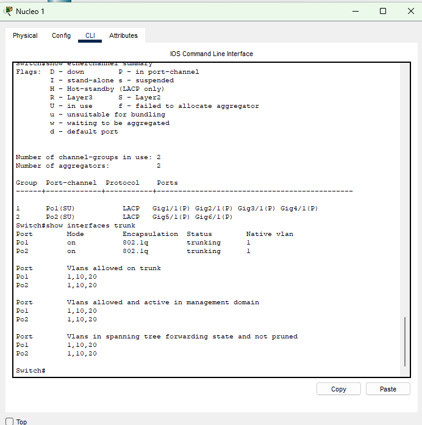

**Nucleo 2**

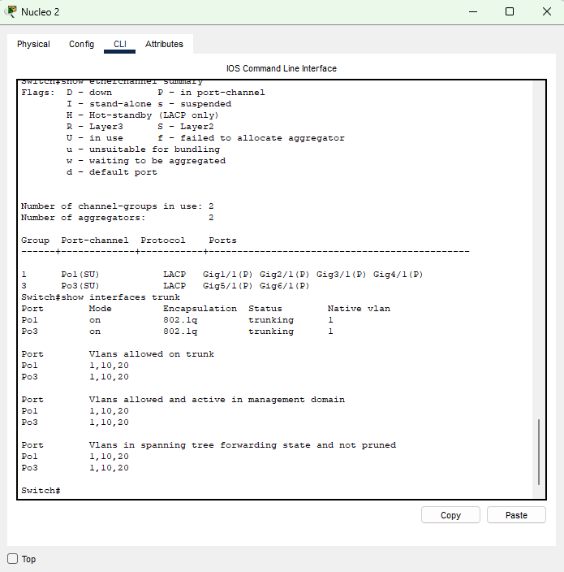

**Dist 1**

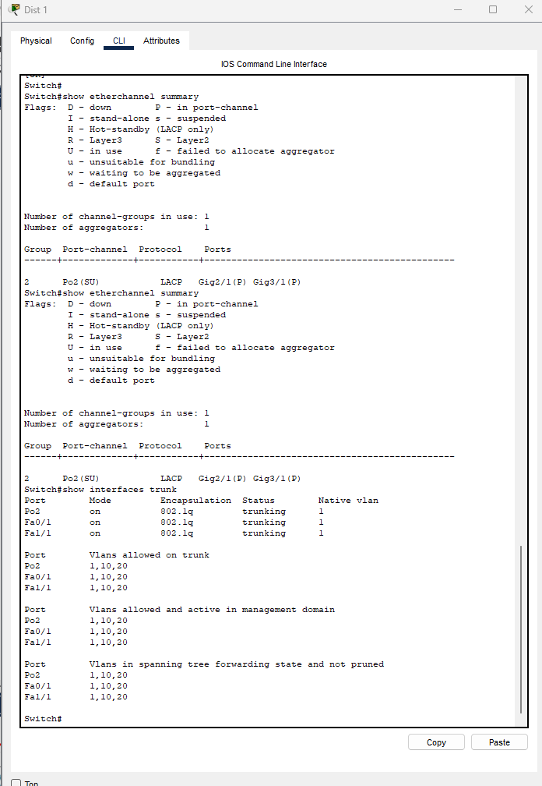

**Dist 2**

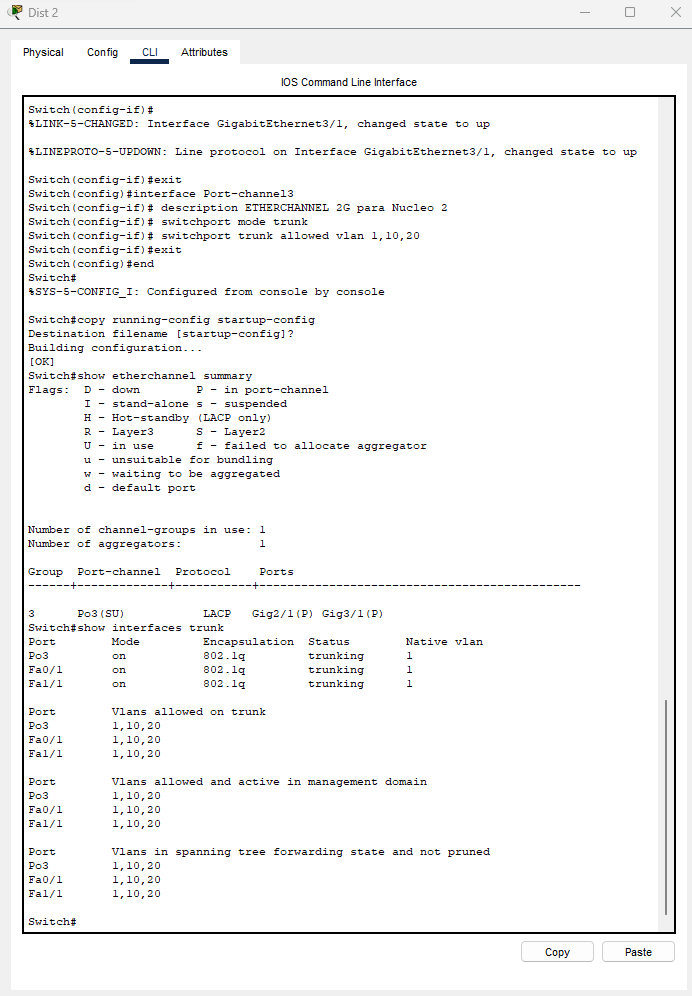

### 6.2 Largura de banda dos canais

Saída de `show interfaces port-channel 1` e `show interfaces port-channel 2` no Nucleo 1:

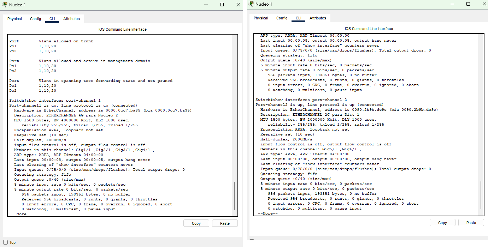

### 6.3 Testes de conectividade ponta a ponta

| Teste | Origem → Destino | VLANs | Caminho percorrido | Resultado |
|---|---|---|---|---|
| `ping 192.168.10.12` | PC0 (192.168.10.10) → PC2 (192.168.10.12) | 10 → 10 | Acesso 1 → Dist 1 → Po2 → Nucleo 1 → Po1 → Nucleo 2 → Po3 → Dist 2 → Acesso 3 | Sucesso |
| `ping 192.168.10.13` | PC0 (192.168.10.10) → PC3 (192.168.10.13) | 10 → 10 | Acesso 1 → Dist 1 → Po2 → Nucleo 1 → Po1 → Nucleo 2 → Po3 → Dist 2 → Acesso 4 | Sucesso |
| `ping 192.168.20.13` | Laptop0 (192.168.20.10) → Laptop3 (192.168.20.13) | 20 → 20 | Acesso 1 → Dist 1 → Po2 → Nucleo 1 → Po1 → Nucleo 2 → Po3 → Dist 2 → Acesso 4 | Sucesso |
| `ping 192.168.20.12` | PC0 (192.168.10.10) → Laptop2 (192.168.20.12) | 10 → 20 | — | Falha (esperado: sem roteamento entre VLANs) |
| `tracert 192.168.10.12` | PC0 (192.168.10.10) → PC2 (192.168.10.12) | 10 → 10 | Acesso 1 → Dist 1 → Po2 → Nucleo 1 → Po1 → Nucleo 2 → Po3 → Dist 2 → Acesso 3 | 1 salto: 192.168.10.12 (switches de camada 2 não aparecem) |
| `tracert 192.168.20.13` | Laptop0 (192.168.20.10) → Laptop3 (192.168.20.13) | 20 → 20 | Acesso 1 → … → Acesso 4 | 1 salto: 192.168.20.13 |

Pings executados no PC0:

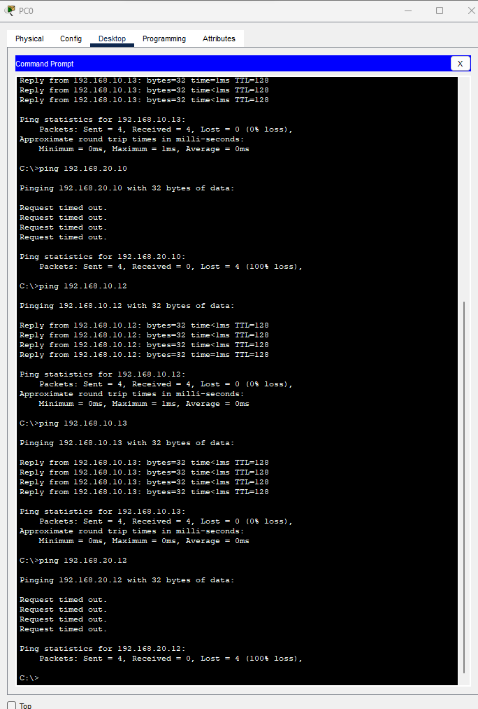

Tracert no PC0 (VLAN 10) e ping/tracert no Laptop0 (VLAN 20):

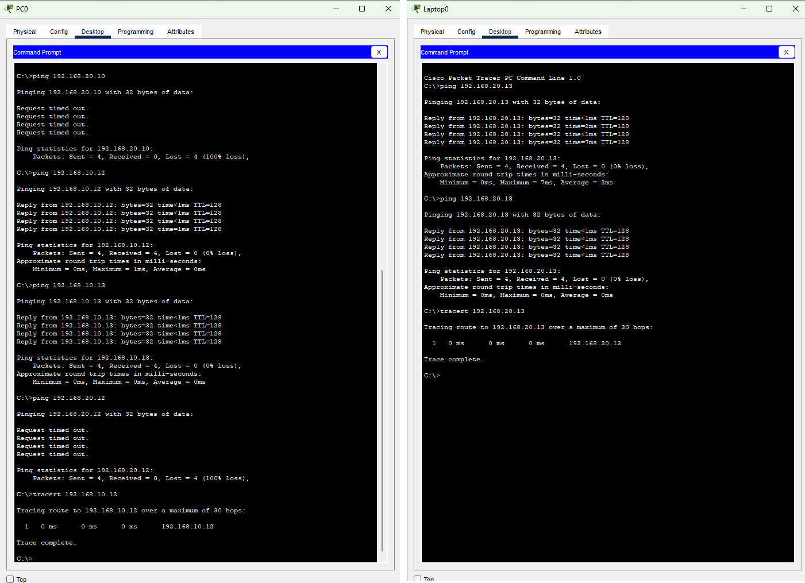

O `tracert` mostra apenas um salto porque origem e destino estão na mesma VLAN e na mesma rede IP: não há roteador no caminho, e os switches (camada 2) não decrementam o TTL. O caminho pelos canais de agregação foi confirmado no modo Simulação do Packet Tracer.

No modo Simulação, a lista de eventos do ping PC0 → PC2 mostra o percurso PC0 → Acesso 1 → Dist 1 → Nucleo 1 → Nucleo 2 → Dist 2 → Acesso 3 → PC2, passando pelos Port-channels 2, 1 e 3.

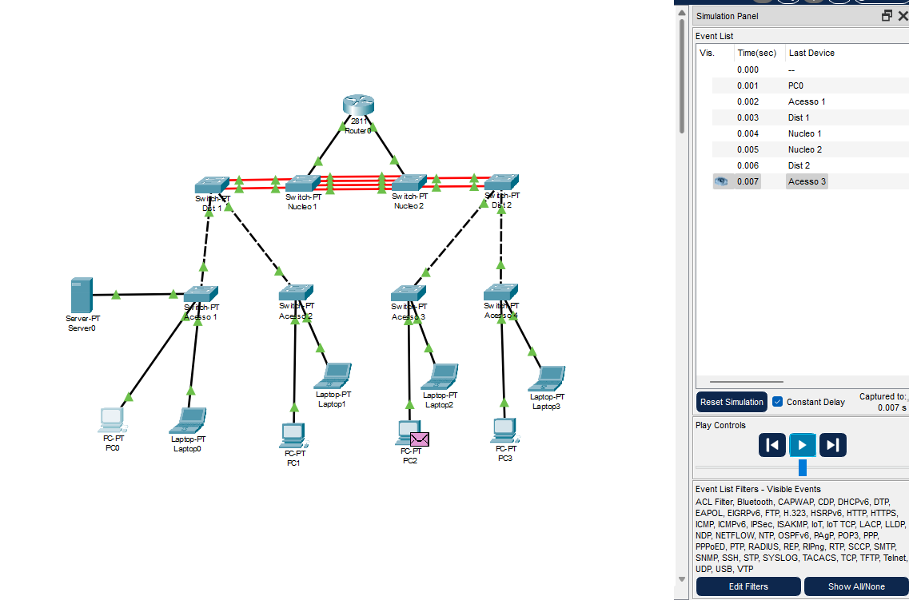

### Teste de redundância

Com `ping -t` em execução de PC0 para PC2, a interface GigabitEthernet1/1 do Nucleo 1 foi desligada (`shutdown`). O `show etherchannel summary` passou a mostrar a Gig1/1 com flag `(D)`, enquanto o Port-channel1 continuou `(SU)` com os outros 3 membros, e o ping seguiu respondendo sem perdas. Em seguida, a interface foi religada (`no shutdown`).

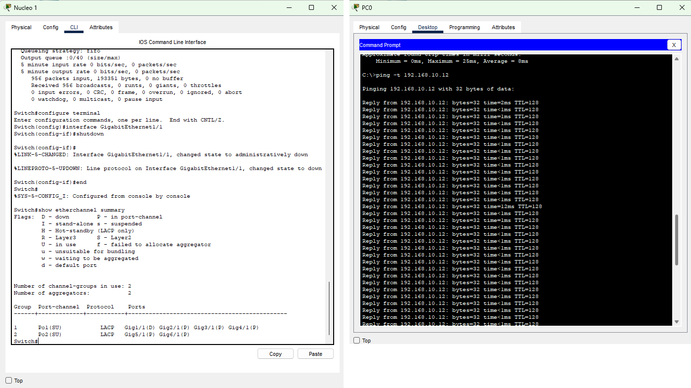

## 7. Observações

- Antes da agregação, o Spanning Tree bloqueava parte dos cabos paralelos (Núcleo–Núcleo e Núcleo–Distribuição). Com os Port-channels, todos os cabos passam a encaminhar tráfego.
- Os enlaces Distribuição–Acesso possuem um único cabo e foram mantidos como trunk individual, configurado na Avaliação 07.
- O ping entre VLANs diferentes continua falhando, como esperado, pois não há roteamento entre VLANs.
- Cada fluxo individual usa um único membro do canal; a capacidade de 2 ou 4 Gbps é a capacidade agregada.

## 8. Arquivos do repositório

| Arquivo | Conteúdo |
|---|---|
| `README.md` | Este tutorial |
| `topologia.png` | Diagrama atualizado com portas e Port-channels |
| `etherchannel-*.png` | `show etherchannel summary` e `show interfaces trunk` |
| `banda-port-channel.png` | Largura de banda dos Port-channels |
| `teste-ping.png` / `teste-tracert.png` | Testes de conectividade |
| `simulacao-caminho.png` | Caminho do pacote no modo Simulação |
| `teste-redundancia.png` | Teste de redundância |
| `Atividade_08.pkt` | Arquivo do Cisco Packet Tracer |

## 9. Referências

- Slides da disciplina TCN.0639 – Comutação de Redes Locais (slide 06: `show etherchannel`).
- IEEE 802.3ad / IEEE 802.1AX – Link Aggregation.
- Cisco Networking Academy – Packet Tracer: Configure EtherChannel (PAgP e LACP).
- Documentação Cisco IOS dos switches Catalyst (configuração de EtherChannel).